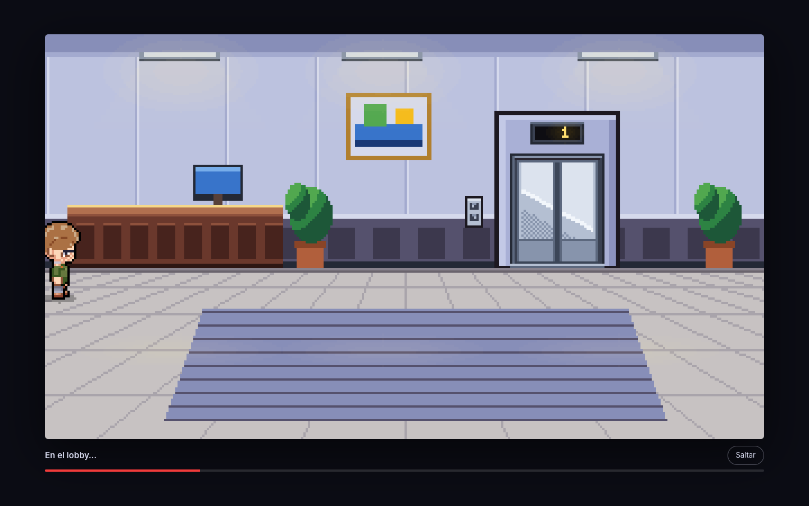
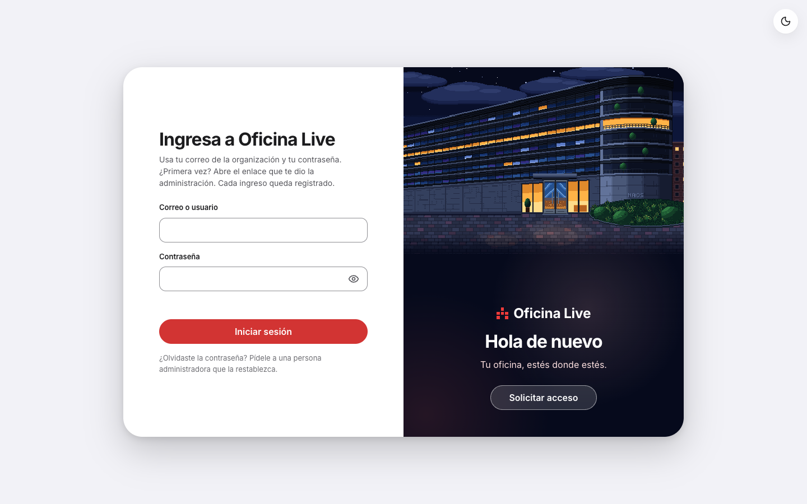
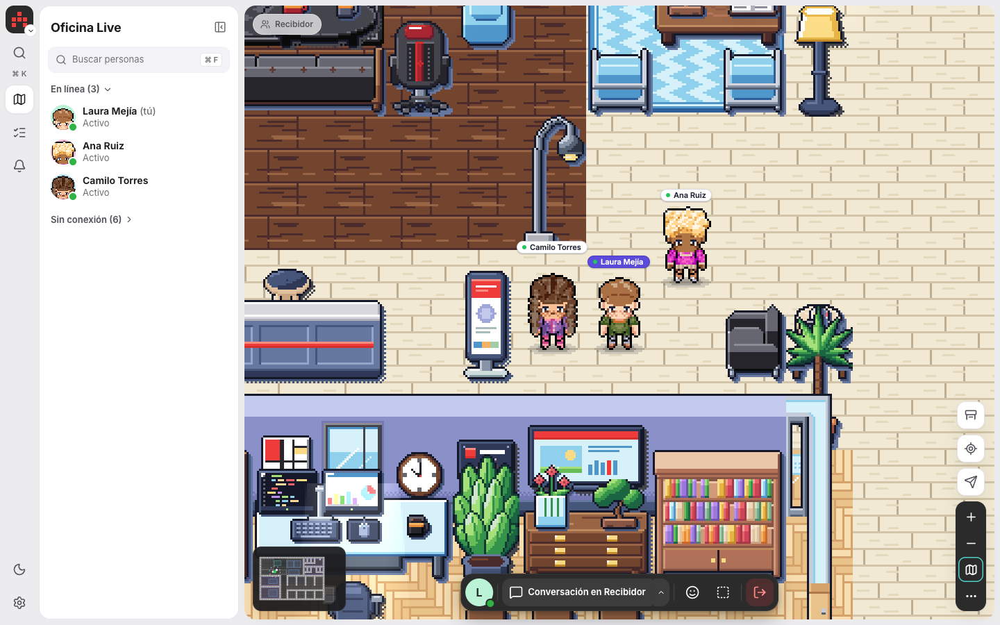
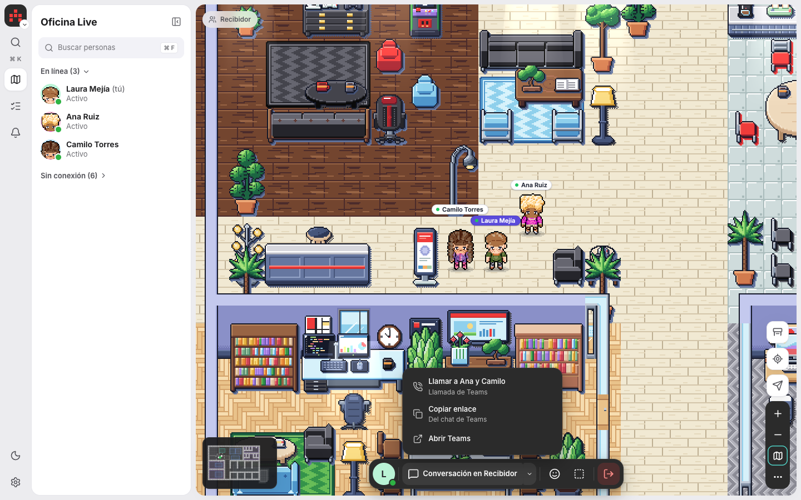
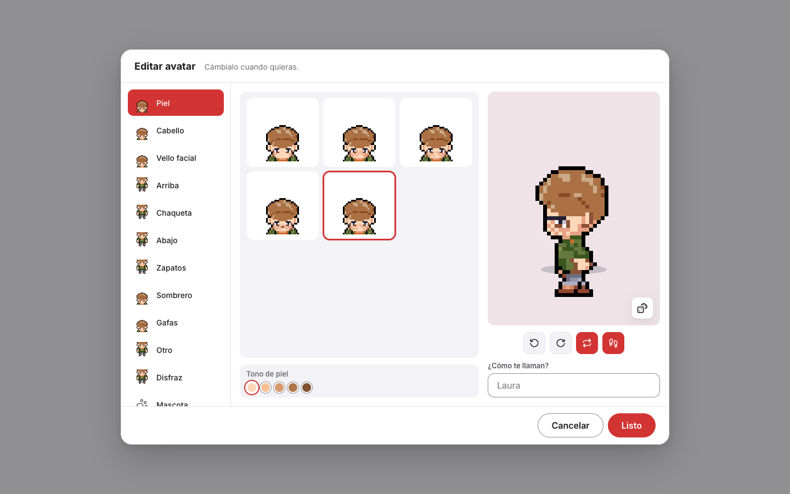
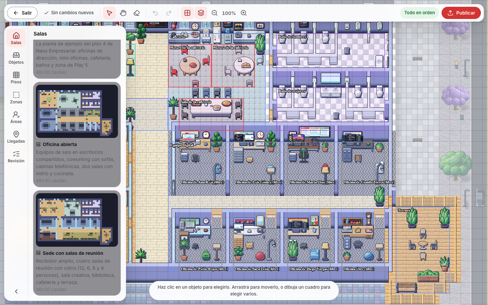
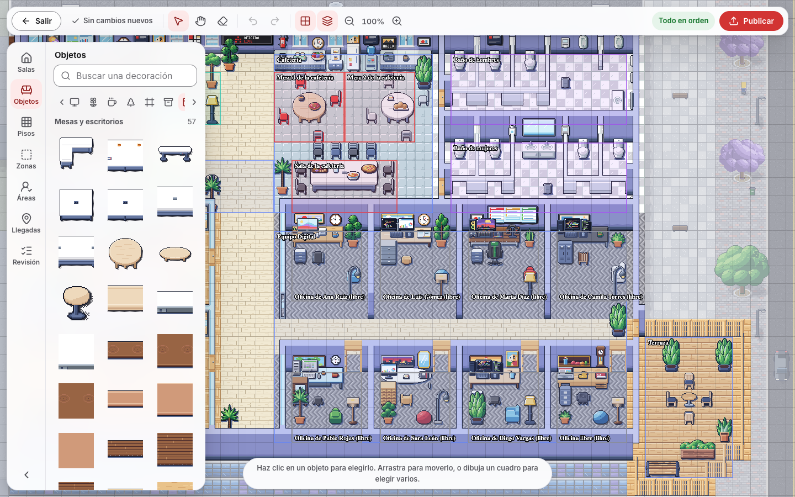
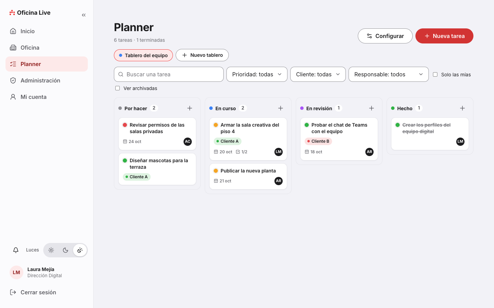
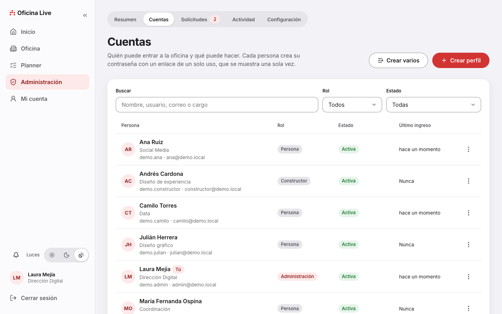

# Oficina Live

Una oficina virtual en pixel art para equipos que trabajan juntos. Cada persona tiene su personaje, camina por el piso, se sienta, entra a las salas y ve quién está cerca. Con un clic salta a un chat o una llamada de Microsoft Teams. Solo para computador.

Autores: [Jaime O.](https://jaimeai.co/) con [Claude](https://claude.com/claude-code) (Anthropic)



## Qué hace

- **Oficina en tiempo real:** el mundo es un mapa de casillas de 32 px. Se ve a las demás personas moverse, saludar y sentarse en sus puestos.
- **Personajes propios:** 11 categorías de ropa y rasgos (piel, cabello, vello facial, camiseta, chaqueta, pantalón, zapatos, sombrero, gafas, otros y disfraces), caminar de 4 cuadros por dirección y mascotas.
- **Sentarse como en la vida real:** las sillas se pueden cruzar. La persona se sienta solo si se detiene encima. Una silla ocupada bloquea.
- **Puertas y sonidos:** las puertas se abren al cruzarlas y se cierran detrás. Los pasos y demás sonidos se sintetizan con Web Audio, sin archivos de audio.
- **Salas y zonas:** salas abiertas, silenciosas o privadas, con aviso arriba a la izquierda de en qué sala estás. Las privadas se bloquean.
- **Teams:** el botón de la barra cambia según dónde estés. En una sala abre su chat. Cerca de alguien abre el chat con esa persona. Las llamadas salen con un enlace de Teams.
- **Editor de la oficina:** dibuja pisos, paredes, zonas y áreas, coloca objetos de un catálogo de cientos, y carga plantillas (Piso 4 Naos, Oficina abierta, Sede con salas de reunión). Los objetos pequeños se apoyan solos sobre las mesas y el validador avisa de lo que quedó suelto.
- **Planner interno:** tableros con columnas, prioridades, clientes, responsables, subtareas y fechas.
- **Cuentas y permisos:** nadie se registra solo. La administración crea perfiles y cada persona abre su enlace de un solo uso para elegir contraseña. Hay tres roles: administración, constructor y persona.
- **Administración:** resumen, cuentas, solicitudes de acceso, registro de actividad, configuración y respaldos.

## Capturas

| | |
|---|---|
|  |  |
| Ingreso con la fachada de noche | La oficina, con presencia en tiempo real |
|  |  |
| Botón de Teams según el lugar | Creador de personaje |
|  |  |
| Editor: plantillas de oficina | Editor: catálogo de objetos |
|  |  |
| Planner | Administración de cuentas |

## Cómo funciona

```
Navegador (React + Phaser) ──HTTP──► API (Express) ──► SQLite (Prisma)
        │                                 │
        └────────── WebSocket ───────────►└─► presencia en tiempo real
                                          └─► enlaces de Teams (el servidor los arma)
```

- **`web`** dibuja el mundo con Phaser 3 y la interfaz con React 19. Los correos de otras personas nunca llegan al navegador.
- **`server`** es una API de Express 5 con SQLite local y un WebSocket de presencia. Aplica las migraciones solo al arrancar.
- **`shared`** es lógica pura que usan los dos: el modelo del mapa, el validador, las plantillas, los catálogos, los permisos y el protocolo.
- **`arte`** dibuja por código todos los sprites con una paleta cerrada y los empaqueta en atlas. No hace falta para usar la plataforma: los atlas ya van en `web/public/assets/arte/`.

## Estructura

| Ruta | Qué es |
|---|---|
| `web/` | Interfaz (React) y mundo (Phaser): HUD, editor, creador de personaje, Planner y administración |
| `server/` | API, presencia, cuentas, Teams, respaldos y base de datos (`prisma/`) |
| `shared/` | Contratos y lógica pura: mapa, plantillas, catálogos, permisos y protocolo |
| `arte/` | Pipeline de pixel art por código y sus guías (`GUIA-*.md`) |
| `docs/ACCESOS.md` | Cómo entrar, crear perfiles, roles y cuentas de la demostración |
| `docs/capturas/` | Capturas de este README |
| `.env.example` | Plantilla de variables `OL_*`; se copia como `.env` |
| `iniciar.command`, `demo.command` | Arranque con doble clic en macOS |
| `CLAUDE.md` | Notas técnicas y reglas del proyecto (para Claude Code) |
| `AVISOS.md` | Atribuciones y licencias de terceros |

## Requisitos

- Node.js 24 o superior (`.nvmrc` fija la versión) y npm.
- Un navegador de escritorio actual (Chrome, Edge, Firefox o Safari). En celulares se pide el sitio de escritorio.
- Opcional: Microsoft Teams, para los chats y las llamadas.

No se necesita una base de datos aparte: se crea un archivo SQLite en la carpeta de datos.

## Ponerlo a andar en tu computador

**1. Clonar e instalar**

```bash
git clone https://github.com/Jaimex78/oficina-live.git
cd oficina-live
npm install
```

**2. Ver la demostración**

Trae cuentas de ejemplo y no toca datos reales:

```bash
npm run demo
```

Entra a http://localhost:5190 con `demo.admin` y la contraseña `DemoLocal2026x`. Están todas las cuentas en [docs/ACCESOS.md](docs/ACCESOS.md).

**3. O arrancar tu propia oficina**

Define el correo de la primera cuenta de administración y arranca:

```bash
OL_ADMIN_CORREO=tu@correo.com npm run local
```

La consola muestra un enlace de un solo uso para crear tu contraseña. Ábrelo, entra y arma tu oficina desde el editor (menú, «Editar la oficina», panel Salas). Los datos quedan en `data-local/`, fuera de git.

Las variables disponibles están en `.env.example`.

## Probar y comprobar

```bash
npm run typecheck
npm test
npm run build
```

`npm test` corre las pruebas de `shared`, `server`, `web` y `arte`.

## Regenerar el arte

El arte se dibuja por código. Para reconstruir los atlas:

```bash
npm run arte -- --publicar
```

Las guías del estilo y de cada familia de objetos están en [`arte/`](arte/).

## Fuentes y créditos

- **Estilo:** inspirado en la experiencia de [Gather](https://www.gather.town/). Oficina Live no tiene relación con Gather y no usa su código ni sus gráficos.
- **Arte:** el personaje base y todo el pixel art son de Jaime Orozco. Se dibujan por código con una paleta propia.
- **Tipografías:** Inter y JetBrains Mono (SIL OFL 1.1).
- **Dependencias:** Phaser, React, Vite, Express, Prisma, ws, jose, zod, sharp y más. La lista con sus licencias está en [AVISOS.md](AVISOS.md).
- **Teams:** Microsoft Teams es marca de Microsoft. Oficina Live solo arma enlaces profundos y no está afiliado a Microsoft.

## Seguridad

- **Cuentas sin contraseña inicial:** cada perfil nuevo se activa con un enlace de 256 bits, de un solo uso, que vence en 7 días. En la base solo queda su huella.
- **Contraseñas** con scrypt. Bloqueo temporal tras intentos fallidos y límite por IP.
- **Sesión** con un token firmado en la cabecera `Authorization`, sin cookies. Cambiar la contraseña la revoca.
- **Origen y CSRF:** toda escritura exige la cabecera `X-OL`, y el WebSocket valida el origen.
- **Privacidad:** el navegador nunca recibe listas de correos; el servidor arma los enlaces de Teams.
- **Datos locales:** la base, las fotos, los respaldos y el secreto viven en `data*/` y `.env`, que están en `.gitignore`.

Para reportar una vulnerabilidad, mira [SECURITY.md](SECURITY.md).

## Contribuir

Las propuestas son bienvenidas, aunque el proyecto no tiene una licencia abierta. Lee [CONTRIBUTING.md](CONTRIBUTING.md) y el [código de conducta](CODE_OF_CONDUCT.md).

## Licencia

© 2026 Jaime Orozco. **Todos los derechos reservados.** El código se publica para que se pueda leer y estudiar, pero no se puede copiar, modificar, distribuir ni usar sin permiso por escrito. Los detalles están en [LICENSE](LICENSE). Los componentes de terceros conservan sus licencias ([AVISOS.md](AVISOS.md)).
